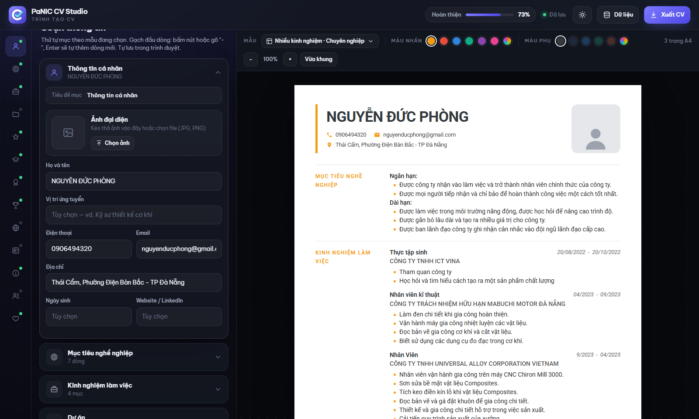
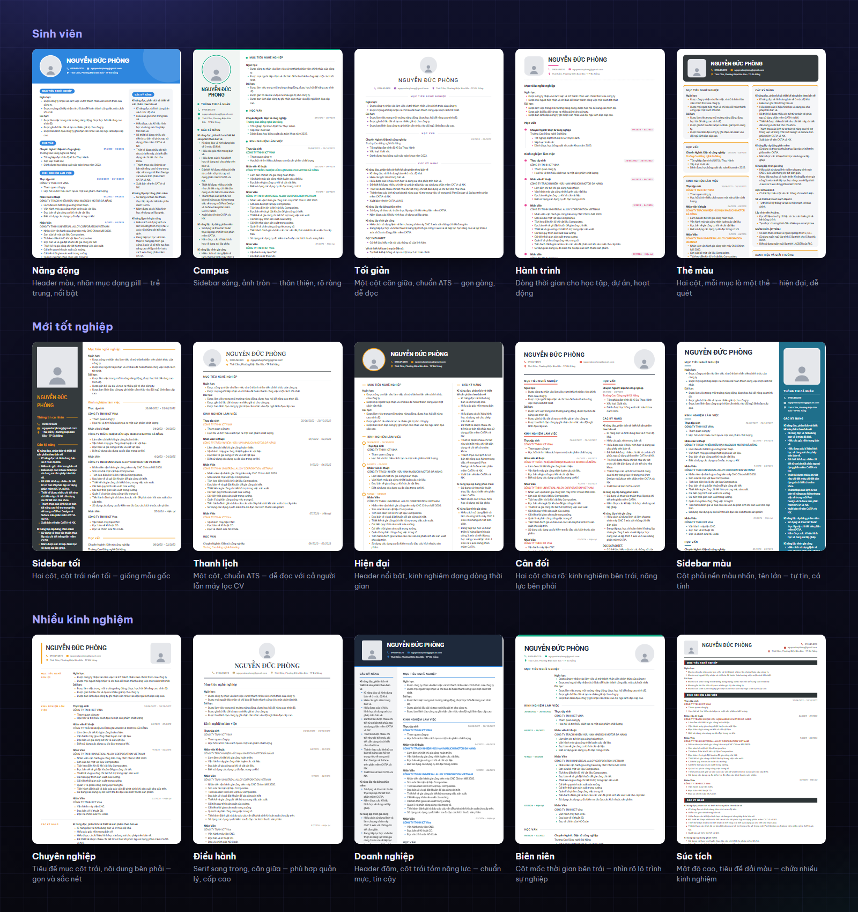
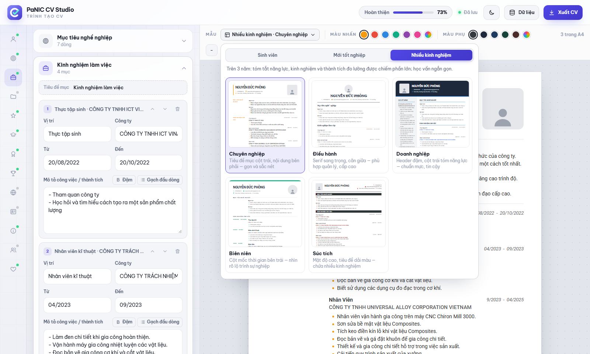

  

<h1 align="center">PaNIC CV Studio</h1>

<strong>Tạo CV đẹp, chuẩn nhà tuyển dụng — trong vài phút.</strong>

Chọn mẫu theo đúng giai đoạn sự nghiệp của bạn, điền nội dung và xem CV thành hình ngay bên cạnh. Khi ưng ý, xuất ra PDF, ảnh PNG hoặc một trang web độc lập. Miễn phí, không cần đăng ký.

  
  
  

<a href="#mau"><strong>Bộ mẫu</strong></a> · <a href="#ba-buoc">Ba bước</a> · <a href="#tinh-nang">Tính năng</a> · <a href="#meo">Mẹo viết CV</a> · <a href="#hoi-dap">Hỏi đáp</a>

## Soạn bên trái, CV thành hình bên phải

Mỗi chữ bạn gõ hiện ngay trên trang A4 thật. Thứ tự các mục tự sắp theo mẫu đang chọn, mục nào để trống sẽ tự ẩn khỏi CV, và vạch kẻ cho biết chỗ ngắt trang khi xuất PDF.

## 15 mẫu cho 3 giai đoạn sự nghiệp

Một CV tốt không chỉ đẹp — nó đặt điều quan trọng nhất của bạn lên đầu. Vì vậy mẫu được chia theo đối tượng, mỗi nhóm có 5 bố cục khác nhau và thứ tự mục riêng:

| Đối tượng | Nhà tuyển dụng muốn thấy trước tiên | Mẫu |
|---|---|---|
| 🎓 **Sinh viên** | Học vấn, dự án, hoạt động ngoại khóa, kỹ năng | Năng động · Campus · Tối giản · Hành trình · Thẻ màu |
| 🚀 **Mới tốt nghiệp** (0–3 năm) | Mục tiêu rõ ràng, thực tập và công việc đầu tiên | Sidebar tối · Thanh lịch · Hiện đại · Cân đối · Sidebar màu |
| 💼 **Nhiều kinh nghiệm** (3+ năm) | Tóm tắt năng lực, kinh nghiệm và thành tích đo được | Chuyên nghiệp · Điều hành · Doanh nghiệp · Biên niên · Súc tích |

Mỗi mẫu có bảng màu gợi ý riêng, và bạn có thể đổi màu nhấn, màu phụ chỉ với một cú bấm. Thư viện mẫu hiển thị ngay chính nội dung của bạn trên từng bố cục để dễ so sánh.

## Ba bước là xong

## Tính năng

|  |  |
|---|---|
| ⚡ **Xem trước tức thì** | Bản A4 cập nhật theo từng phím gõ, có thu phóng và đếm số trang. |
| 📄 **PDF chuẩn A4** | Chữ sắc nét, chọn và tìm kiếm được; không có dòng ngày giờ hay đường dẫn thừa ở đầu/cuối trang. |
| ✂️ **Ngắt trang gọn gàng** | Không cắt ngang dòng chữ, tiêu đề mục không bị bỏ lơ lửng cuối trang, trang sau tự có lề. |
| 🖼️ **Ảnh PNG & trang HTML** | Ảnh độ phân giải cao để gửi qua chat, hoặc một trang web độc lập để đính kèm. |
| 👤 **Ảnh đại diện** | Kéo thả ảnh vào là xong, ảnh tự căn và cắt vừa khung của từng mẫu. |
| 🧩 **Mục linh hoạt** | Học vấn, kinh nghiệm, dự án, hoạt động, kỹ năng, ngoại ngữ, chứng chỉ, giải thưởng, người tham chiếu… đổi tên tiêu đề tùy ý, mục trống tự ẩn. |
| ✍️ **Gõ tự nhiên** | Nút in đậm và gạch đầu dòng; nhấn Enter trong danh sách là có dòng mới. |
| 🌓 **Sáng / tối** | Giao diện dễ chịu cho mắt cả ngày lẫn đêm. |
| 💾 **Tự lưu** | Nội dung được giữ lại trên trình duyệt của bạn; có thể lưu ra file để sửa tiếp trên máy khác. |
| 🔒 **Riêng tư** | Thông tin của bạn chỉ nằm trên máy bạn — không tài khoản, không gửi đi đâu cả. |

## Mẹo để CV được đánh giá cao

1. **Một đến hai trang là đủ.** Nhà tuyển dụng thường chỉ lướt CV trong vài chục giây — hãy giữ những gì liên quan nhất tới vị trí ứng tuyển.
2. **Bắt đầu mỗi gạch đầu dòng bằng động từ và con số.** “Giảm 20% thời gian gia công” mạnh hơn “Tham gia cải tiến quy trình”.
3. **Mới nhất lên trước.** Kinh nghiệm và học vấn xếp theo thời gian gần nhất — các mẫu đã sắp sẵn cho bạn.
4. **Chọn mẫu theo giai đoạn.** Sinh viên nổi bật bằng dự án và hoạt động; người nhiều năm kinh nghiệm nổi bật bằng thành tích.
5. **Ảnh rõ mặt, nền sáng, trang phục lịch sự.** Và đặt tên file theo họ tên của bạn — trang web đã gợi ý sẵn khi xuất.

## Hỏi đáp

<strong>Có mất phí hay phải đăng ký tài khoản không?</strong>

Không. Mở trang là dùng được ngay, mọi mẫu và mọi định dạng tải về đều miễn phí.

<strong>Dữ liệu của tôi được lưu ở đâu?</strong>

Ngay trên trình duyệt bạn đang dùng. Muốn chuyển sang máy khác, mở menu <b>Dữ liệu → Lưu file .json</b>, rồi <b>Mở file .json</b> trên máy mới.

<strong>Xuất PDF thế nào?</strong>

Bấm <b>Xuất CV → PDF</b>, ở hộp thoại hiện ra chọn đích <b>“Lưu dưới dạng PDF”</b> rồi bấm Lưu. Nhớ để bật <b>“Đồ họa nền”</b> (Background graphics) để giữ màu sắc của mẫu. Tên file được đặt sẵn theo họ tên của bạn.

<strong>Có viết CV tiếng Anh được không?</strong>

Được. Tiêu đề từng mục đều đổi được (ví dụ “Kinh nghiệm làm việc” → “Work Experience”), nội dung bạn viết bằng ngôn ngữ nào cũng hiển thị đúng.

<a href="https://panic-create-cv.vercel.app"><strong>→ Bắt đầu tạo CV ngay</strong></a> · <a href="#top">Lên đầu trang ↑</a>

